# Original supplied screenshots

These 18 PNGs retain the original image bytes, without cropping, redrawing, recompression, or other edits. Images 01-08 were saved with the November 11 evidence. Images 09-15 document the supplementary outline and risk-analysis evidence supplied on November 27, 2026; images 16-18 preserve excerpts of the earlier November 11 audit, also supplied on November 27. The outline prompt already in this folder was reused as image 09 instead of adding a second copy of the same prompt. The later images are grouped by prompt and response for reading.

The screenshots are excerpts of the historical chat. They show the prompts and selected response sections; omitted sections and downloadable archive contents cannot be reconstructed from them. Model versions are not visible. The P6 audit screenshot shows "Wed, Nov 11 at 8:20 AM"; the original conversation dates of the other supplied excerpts are not visible. Written transcriptions are provided for search/accessibility alongside these primary image artifacts.

## P1: requirements analysis

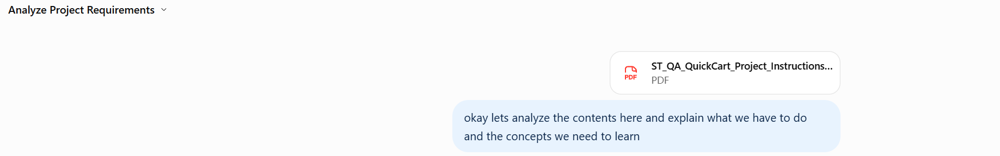

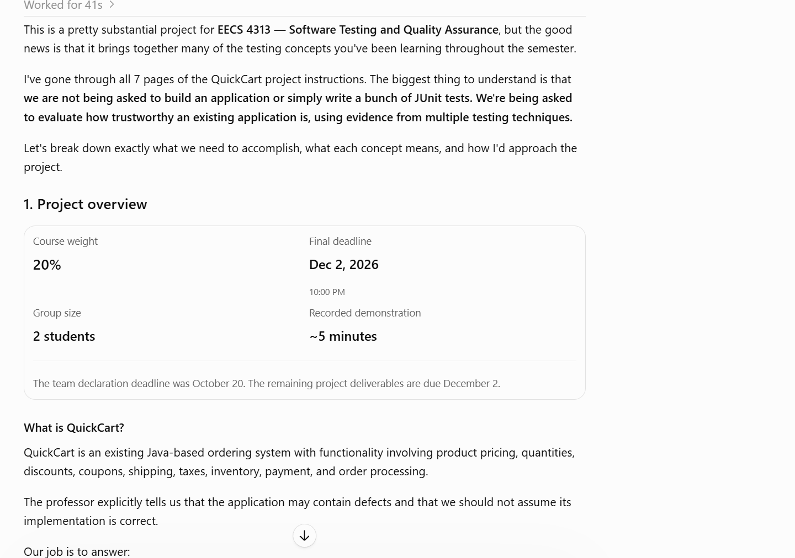

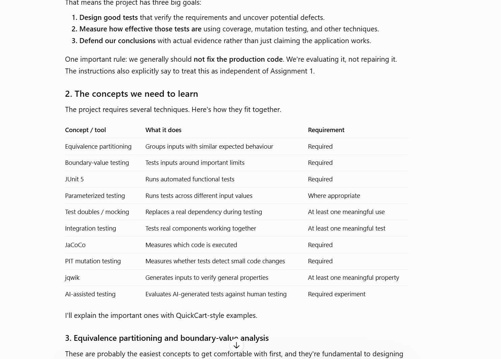

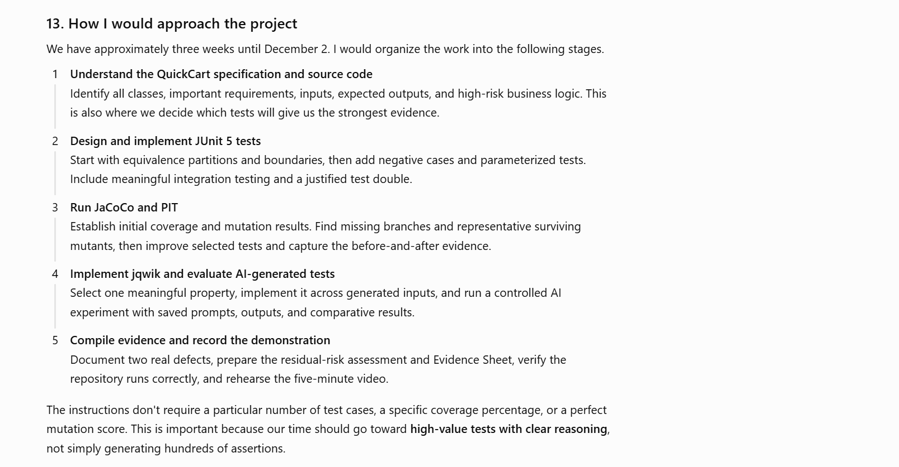

## P2: proposed project skeleton

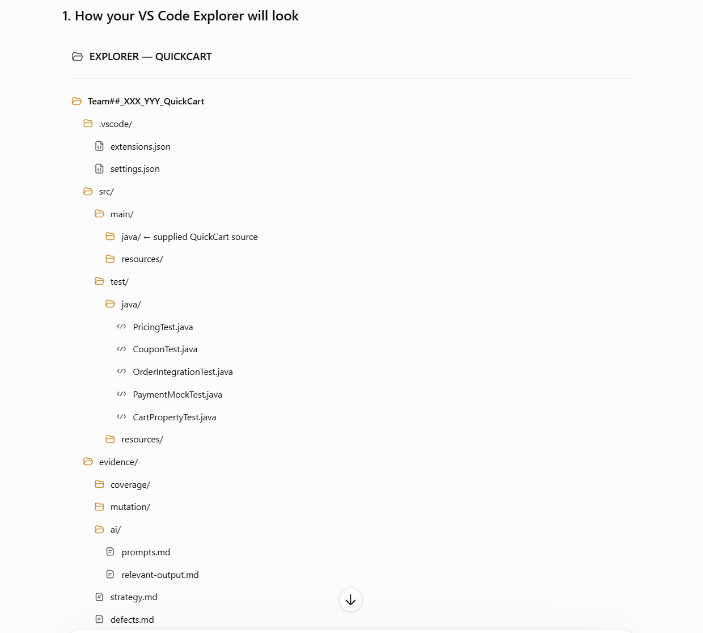

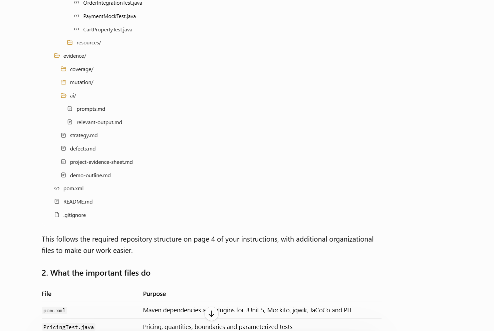

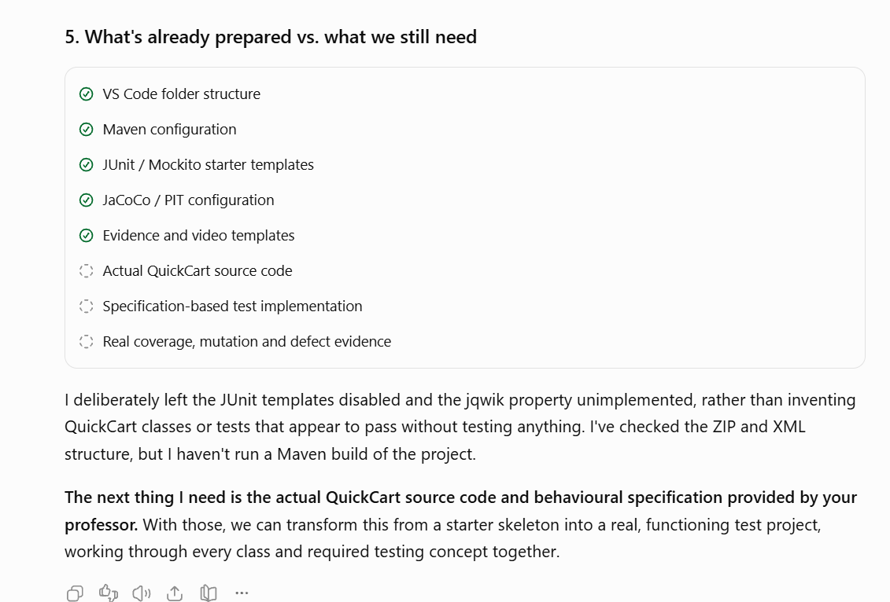

## P4: supplementary project-requirements outline

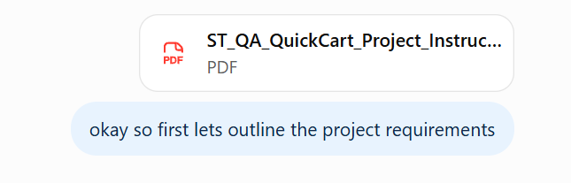

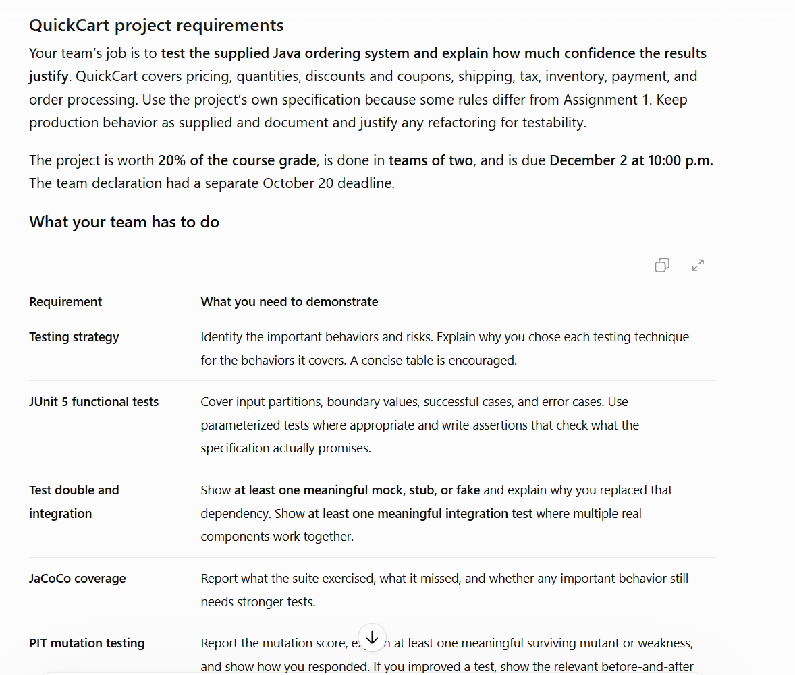

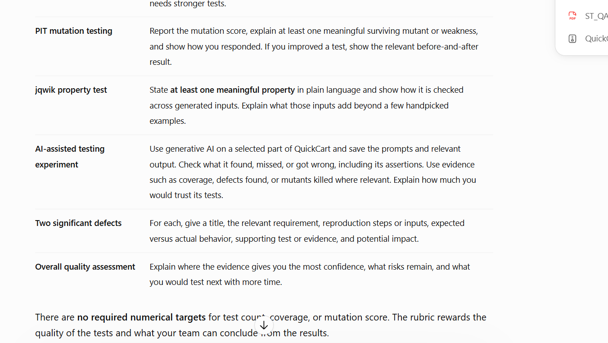

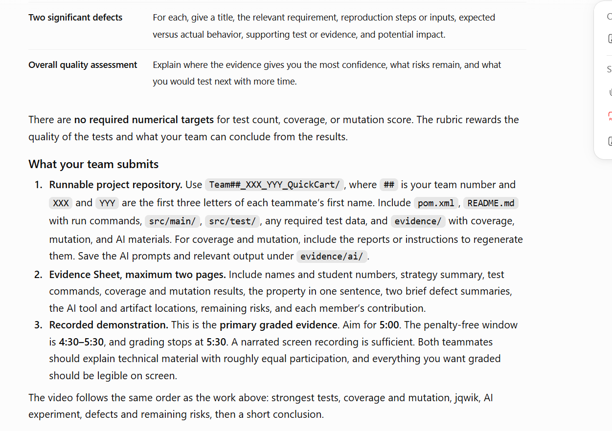

## P5: risk-based testing request and reported findings

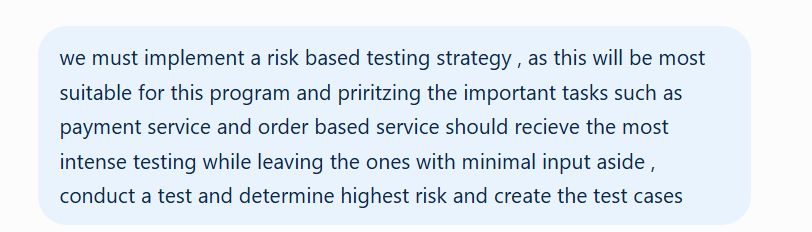

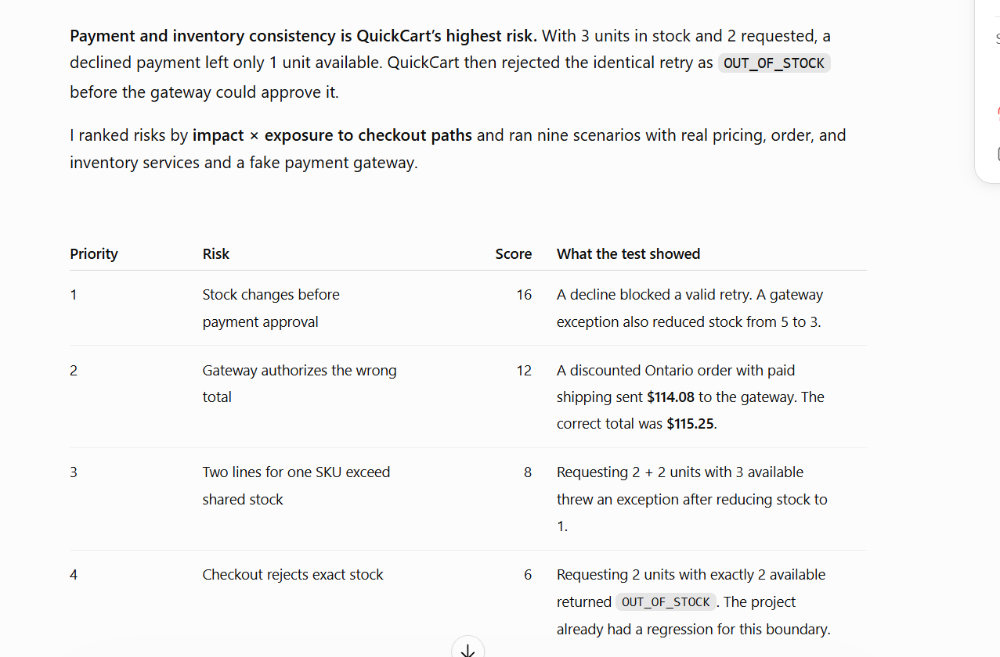

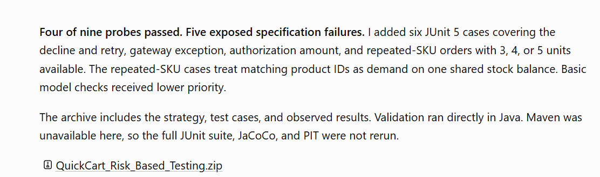

The P5 images preserve the AI response's reported results. They do not include the linked archive, executable test bodies, or raw probe output. See [the output transcription](../relevant-output.md) and [critical evaluation](../evaluation.md) for the distinction from the repository's measured results.

## P6: historical repository audit

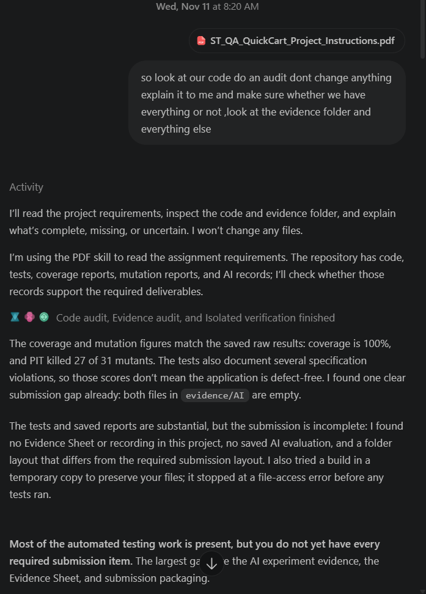

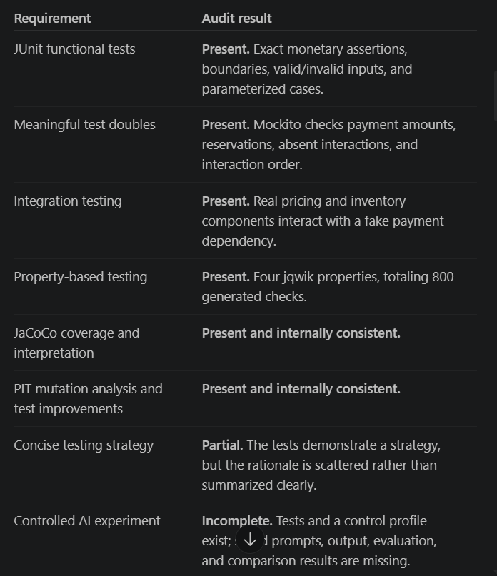

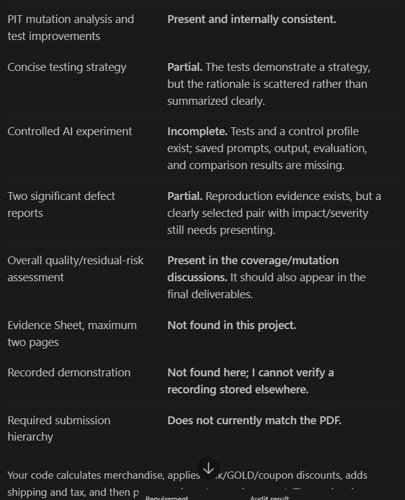

These findings describe the repository at the time of that audit. The AI evidence, strategy/defect notes, and source layout were completed or updated afterward. The missing-item statements and intermediate file-access error are not a new assessment of the current repository. See [the P6 output notes](../relevant-output.md) and [evaluation](../evaluation.md) for that context.
